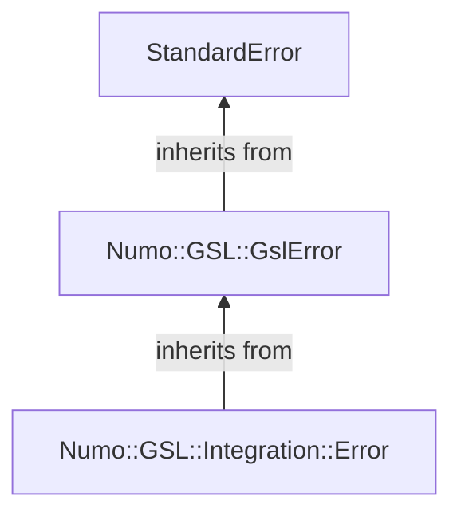

# GSL error handling

`numo-gsl-alt` installs the process-wide GSL error handler that converts GSL errors to `Numo::GSL::GslError`. `numo-gsl-integration` neither replaces nor temporarily disables that handler.

Errors reported by GSL are raised directly as `Numo::GSL::GslError` by the handler installed by `numo-gsl-alt`. `numo-gsl-integration` does not convert integration return statuses into separate exceptions.

The workspaces used by QAG, QAGS, QAGP, QAGI, QAGIU, QAGIL, QAWC, QAWS, QAWO, QAWF, CQUAD, and Romberg are released when a call completes normally or raises an exception. QAWS, QAWO, and QAWF also release their weight tables, and QAGP releases its temporary copy of the point array.

`Numo::GSL::Integration::Error` is reserved for validation or state errors detected by `numo-gsl-integration` itself. It inherits from `Numo::GSL::GslError`:

Code can rescue all GSL-related errors with `Numo::GSL::GslError`, or rescue `Numo::GSL::Integration::Error` when it needs to handle only errors detected by the integration wrapper.

The GSL error handler is shared by the entire process. This gem leaves its ownership with `numo-gsl-alt` and does not switch the handler around individual integration calls.
